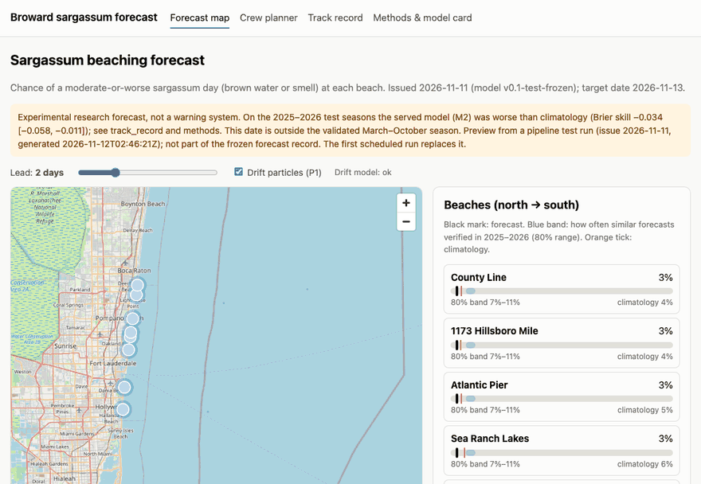
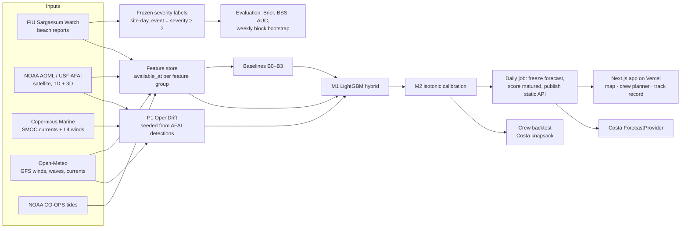

# sargassum-forecast

A beach-level sargassum forecast for 8 Broward County, Florida beaches. Each forecast is scored against FIU Sargassum
Watch citizen-science reports. The system combines NOAA/USF satellite sargassum detections (AFAI), a Lagrangian drift
model (OpenDrift with Copernicus currents), a LightGBM hybrid, and a crew-allocation planner built on Costa's exact
knapsack. A daily GitHub Action issues and freezes a forecast and publishes a static API. A small web app reads that API.

**Live app:** https://sargassum-forecast.vercel.app · **Static API:** `/api/v1/forecast/latest.json`,
`/api/v1/track_record.json`, `/api/v1/sites.json` · Experimental research forecast, **not a warning system**.



## The result, up front

Two seasons were held out and scored once: 2025 and 2026. 2026 had the highest beach event rate in the FIU record (0.359; 2025: 0.198;
`outputs/feasibility/fiu_season_stats.csv`). After the models were frozen
(tag `v0.1-test-frozen`), **no model that uses only information available at forecast time beat a per-beach
seasonal climatology**, pooled over seasons and leads. This is a negative result, and it is the main finding.

| Model (2025–2026 pooled, leads 1–7 days pooled) | Inputs | Brier skill vs climatology [95% CI] | ROC-AUC [95% CI] |
| --- | --- | --- | --- |
| B1 climatology | issue-time | 0 (reference) | 0.701 [0.651, 0.743] |
| B0 persistence (latest beach report) | issue-time | −0.011 [−0.029, 0.006] | 0.616 [0.578, 0.649] |
| M1_fc LightGBM, issue-time inputs only | issue-time | −0.018 [−0.040, 0.005] | 0.671 [0.620, 0.716] |
| P1 drift model alone | upper bound¹ | −0.025 [−0.057, 0.004] | 0.592 [0.551, 0.626] |
| M1 LightGBM hybrid | upper bound¹ | **0.064 [0.032, 0.096]** | 0.724 [0.678, 0.767] |
| M2 = M1 + isotonic calibration fit on 2024 (the served model) | upper bound¹ | **−0.034 [−0.058, −0.011]** | 0.720 [0.676, 0.762] |

¹ "Upper bound" models were trained and tested with winds, waves, currents and drift forcing *observed on the target
day*, not with forecasts available at issue time. Source: `outputs/results_test.csv` (rows `season == "2025-2026"`,
`lead == "all"`). All intervals are 95% weekly block bootstrap (1,000 resamples). A difference counts only if its interval
excludes zero.

What else the test showed (details and every source in **[docs/RESULTS.md](docs/RESULTS.md)**):
- **Validation results reversed on test.** On the 2024 validation season, M1, M2, M1_fc and M2_fc all beat climatology on Brier,
  including the issue-time M1_fc. Those scores were optimistic, because M1 was tuned and M2 was calibrated on 2024.
- **Calibration on one quiet season hurt.** 2024 had an event rate of 0.092, against 0.198 and 0.359 in the test years. In 2026 every
  model's mean forecast (0.127–0.206) was below the observed rate of 0.359.
- **The drift physics added nothing detectable.** Removing P1 from M1 changes Brier by +0.0004 [−0.0004, +0.0012].
- **The skill M1 has needs target-day weather and ocean conditions.** M1 beat climatology on Brier only in 2026, and it
  never out-ranked climatology (AUC difference +0.0231 [−0.0067, +0.0549]).
- **Crew-planning backtest (simulated):** planning from the forecast never beat planning from climatology, across all 21
  combinations of budget (4–16 crew-hours) and booking lead (1–3 days). The served-model policy, which is upper bound like M2, was
  significantly worse in 2 of the 21 (1-day booking, 14 and 16 h). The issue-time M2_fc policy was worse in 9 of 21. Climatology beat
  "go where it was last reported" at every budget at a 2-day booking lead (`outputs/backtest_test.csv`).

The live 2027 season is the next real test. Forecasts are frozen daily before observations arrive and scored automatically
in `/api/v1/track_record.json`.

## How it works



- **Labels** (`pipeline/labels/fiu_labels.py`). Severity is 0 none, 1 present, 2 brown water or smell, 3 very brown. An event is
  severity ≥ 2, frozen before any model was trained. Same-day reports are merged by taking the worst. Missing days stay missing.
- **Features** (`pipeline/features/`). Every feature group carries an `available_at` timestamp, and a test asserts that it is
  no later than the issue time. The only exceptions are the declared target-day driver groups.
- **Splits.** Train 2020–2023, validate 2024, test 2025–2026, by season and never shuffled. 2019 used an older survey form without the
  water-colour question, so it is used only in a sensitivity run.
- **Models.** B0 persistence, B1 climatology, B2 SIR-style AFAI index, B3 = B2 + onshore wind, P1 OpenDrift arrivals within
  5 km, M1 LightGBM (≤ 50-trial tuning on 2024), M2 = M1 + isotonic calibration on 2024, and M1_fc/M2_fc using issue-time inputs only.
- **Audits.** A leakage review ran before the test seasons were unlocked. An honesty review of every claim checks it against `outputs/`.

## Reproduce

```bash
uv sync                      # Python 3.12, pinned by uv.lock (LightGBM on macOS also needs `brew install libomp`)
uv run copernicusmarine login   # free Copernicus Marine account (currents and winds for P1)
make data                    # pull and cache raw inputs (idempotent). Open-Meteo: stays under 10,000 calls/day
make results                 # rebuilds every results table and figure from cached raw data (mostly OpenDrift runs)
make test                    # pytest + ruff + mypy + the TypeScript knapsack test
uv run python -m ops.daily --scratch /tmp/run   # one end-to-end daily forecast without touching the record
```

`make results` re-scores the test seasons only if the retrained model hash matches the frozen one (`eval/run_test.py`).
The web app is in `web/` (`npm install && npm run build`, a static export).

## Repository layout

```
pipeline/ingest/    adapters: fiu, afai, copernicus, openmeteo, tides, sir_archive
pipeline/labels/    frozen severity rules          pipeline/features/  AFAI grid + feature store
physics/            OpenDrift forcing, seeding, drift runs, arrivals, P1 scoring
models/             baselines (B0–B3), hybrid (M1/M2), artifacts/ (frozen forecast bundle)
eval/               metrics, block bootstrap, validation/test runners, figures, failure gallery
decision/           Costa knapsack port + simulated crew backtest
ops/                daily job, live inputs, empirical intervals, API results publisher
web/                Next.js app (static export) + TypeScript knapsack
outputs/            every committed table and figure; forecasts/ and track_record.json (daily)
docs/               SPEC, FEASIBILITY, RESULTS, MODEL_CARD, DATA_SOURCES, WORKLOG
```

## Limitations

- Validated only for these 8 beaches and only March–October. The forecast is unvalidated elsewhere and in other months.
- Citizen reports are noisy and uneven (2019–2021 are sparse). A missing report is not a clean beach.
- The served model under-forecasts high-sargassum years (`docs/RESULTS.md`). Its 80% band is an empirical
  correction learned from 2025–2026 outcomes (`outputs/m2_interval_table.csv`).
- Training used analysed weather and ocean drivers, so live forecasts, which use real forecasts, should be expected to do worse than the
  upper-bound test numbers.
- The AFAI record comes from MODIS, which NASA plans to retire in 2027. The daily job opens an issue if any input is stale for more than 3 days.
- The crew backtest is simulated. It considers only beaches that reported on a given day.

## Data and attribution

Beach observations: **FIU Sargassum Watch** (Marine Macroalgae Research Lab). FIU agreed to publication of the derived daily labels;
photos and raw reports are never republished. Satellite AFAI: **NOAA AOML Atlantic OceanWatch / USF Optical
Oceanography Lab** (Hu et al. 2015). Currents and winds: **E.U. Copernicus Marine Service Information**. Winds, waves and point
currents: **Open-Meteo.com** (Météo-France, NOAA GFS). Tides: **NOAA CO-OPS**. SIR archive: **NOAA/USF**. Coastline: Natural
Earth. Drift engine: **OpenDrift** (MET Norway). Map: © OpenStreetMap contributors. Terms for each source:
[docs/DATA_SOURCES.md](docs/DATA_SOURCES.md).

Code: MIT ([LICENSE](LICENSE)). Model card: [docs/MODEL_CARD.md](docs/MODEL_CARD.md). Contact: nareshrajesh787@gmail.com.
